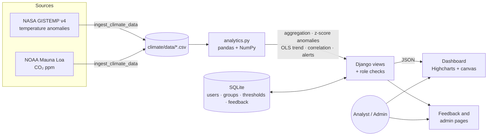

<div align="center">

# 🌍 EarthScape Climate Dashboard

**Interactive climate-change analytics: 146 years of global temperature, 68 years of atmospheric CO₂, anomaly detection, a 2050 projection and threshold alerts, behind role-based access.**


**[Live demo](#live-demo)** · **[Quick start](#quick-start)** · **[Architecture](#architecture)** · **[Requirements coverage](#requirements-coverage)** · **[User guide](#user-guide)** · **[Developer guide](#developer-guide)**

</div>

---

## What is this?

The **EarthScape Climate Agency** needs a platform that lets its analysts explore historical and recent climate data, spot unusual behaviour, project where temperatures are heading, and get warned when key indicators cross agreed limits. This project is a complete, deployable Django implementation of that brief.

Two real, public datasets drive everything:

| Dataset | Source | Coverage |
|---|---|---|
| Global, Northern and Southern Hemisphere **surface temperature anomaly** (vs 1951-1980) | [NASA GISS GISTEMP v4](https://data.giss.nasa.gov/gistemp/) | Jan 1880 → present, monthly |
| **Atmospheric CO₂** concentration, Mauna Loa Observatory | [NOAA Global Monitoring Laboratory](https://gml.noaa.gov/ccgg/trends/) | Mar 1958 → present, monthly |

## Highlights

- 🔐 **Role-based access** with two roles, *Administrators* and *Analysts*, built on Django's auth and groups.
- 🟥🟦 **Warming stripes**: one coloured stripe per year, rendered on a canvas straight from the data.
- 📈 **Six interactive Highcharts views**: temperature by hemisphere with a 5-year average, the Keeling curve, a 2050 projection with a 95% band, CO₂-vs-temperature scatter with regression, warming by decade, and a seasonal profile.
- 🎛️ **Live filtering**: pick any year range or use presets; every chart, KPI and table recomputes server-side.
- 🚨 **Threshold alerts** that turn *warning* then *critical*, with thresholds editable by administrators.
- 🔎 **Anomaly detection** using z-scores against the 1951-1980 reference period.
- 🔮 **Trend prediction** with linear and quadratic least-squares models, validated on a time-ordered holdout.
- 💬 **Feedback & support**: analysts send questions or bug reports, administrators reply and resolve them.
- ⚙️ **Reproducible ingestion**: one management command re-downloads and rebuilds the datasets.

## Live demo

> **URL:** _added after deployment, see the repository's **About** panel._

Sign in with either demo account (also shown on the login page):

| Role | Username | Password | Can do |
|---|---|---|---|
| Administrator | `admin_demo` | `Climate#Admin2026` | Everything an analyst can, plus edit alert thresholds and answer feedback |
| Analyst | `analyst_demo` | `Climate#Analyst2026` | Explore the dashboard, send feedback |

> The hosted demo runs on Vercel's serverless platform, where the filesystem is ephemeral: anything you create (feedback, edits) may disappear on the next cold start. That is a property of the demo hosting, not of the application.

## Quick start

```bash
git clone https://github.com/ari161-bit/climate-change-dashboard.git
cd climate-change-dashboard
python -m venv .venv
.venv\Scripts\activate           # macOS/Linux: source .venv/bin/activate
pip install -r requirements.txt
python manage.py runserver
```

Open <http://127.0.0.1:8000/> and sign in with a demo account. On first run the app copies `deploy/demo.sqlite3` to `db.sqlite3`, so there is no setup step: the groups, thresholds and demo users already exist.

To refresh the datasets from the sources:

```bash
python manage.py ingest_climate_data
```

To recreate groups, thresholds and demo users in any database:

```bash
python manage.py seed_climate
```

## Architecture



**Request flow.** The dashboard page is a thin shell. It calls `GET /data/?start=…&end=…`, a login-protected JSON endpoint, which asks `climate/analytics.py` to compute every chart series, KPI, anomaly table, forecast and alert in one pass. The browser only renders. Heavy numerical work stays on the server, in pandas, and the CSVs are loaded once per process (`lru_cache`).

## Requirements coverage

Mapping of the eProject brief to this implementation, including where a requirement was adapted.

| Requirement | Status | How it is met |
|---|---|---|
| Role-based authentication for administrators and analysts | ✅ | Django auth + `Administrators` / `Analysts` groups. Admin-only views are guarded by `admin_required`; all data endpoints require login. Open-redirect-safe `next` handling. |
| Data ingestion (historical and real-time) | ✅ / ⚠️ | `ingest_climate_data` pulls the latest NASA and NOAA files and normalises them to CSV, so a scheduled run (cron/CI) keeps the data current. Both sources publish monthly, so "real-time" here means *as fresh as the publishers update*. The hosted demo serves the committed snapshot. |
| Data storage and processing | ✅ / ⚠️ | **Adapted.** HDFS/MapReduce are built for terabyte-scale clusters; this data is a few hundred KB. Storage is CSV + SQLite, processing is vectorised **pandas/NumPy**, which keeps the same map-and-aggregate logic without cluster overhead. |
| ML for trend prediction, anomaly detection and correlation | ✅ | Linear + quadratic least-squares trend with holdout RMSE, R² and a 95% band; z-score anomaly detection; Pearson correlation and regression between CO₂ and temperature. See [Analytics methods](#analytics-methods). |
| Interactive dashboards | ✅ | Year-range filters, presets, zoomable/exportable charts, series toggles, KPI cards, warming stripes. |
| Alerts and notifications from thresholds | ✅ / ⚠️ | Four configurable thresholds with ok / warning / critical states shown on the dashboard and admin page. Notifications are **in-app**; email/SMS delivery is out of scope. |
| Feedback and support system | ✅ | Analysts submit categorised messages; administrators respond and mark them resolved; users see replies. |
| Security | ✅ | Django password hashing, CSRF protection, `login_required`/group checks, POST-only logout, input length and type validation, secrets from environment variables, `DEBUG` off in production. |
| Reliability | ✅ | Deterministic computation, defensive parsing (mirror fallback if NOAA is unreachable), graceful handling of bad filter input. |
| Documentation | ✅ | This README (user guide, developer guide, assumptions). |

## User guide

1. **Sign in** at `/login/` with your account.
2. **Read the stripes**: the strip at the top shows the selected years from cool blue to hot red. Hover a stripe for the year and value.
3. **Filter**: set *From* / *To* years and press **Apply**, or use a preset (*All time*, *Since 1950*, *Since 1980*, *Since 2000*).
4. **KPIs** summarise the latest year and month, the record year, current CO₂, CO₂ growth, the warming rate since 1970 and the CO₂-temperature correlation.
5. **Alerts** show whether each indicator is *normal*, *alert* or *critical*.
6. **Charts**: drag to zoom, click legend items to toggle series, use the menu (top right of a chart) to export PNG/SVG/CSV.
7. **Feedback & support**: send a question or report; replies appear under *Your messages*.
8. **Administrators** also get **Alerts & admin**: change thresholds and answer feedback.

## Analytics methods

All maths lives in [`climate/analytics.py`](climate/analytics.py).

- **Aggregation.** Annual means are computed only for years with at least 10 observed months, so a partial current year doesn't distort trends.
- **Anomaly detection.** Each annual mean is converted to a z-score against the mean and standard deviation of the 1951-1980 reference period. Years above **2σ** are flagged.
- **Trend prediction.** `numpy.polyfit` fits a linear and a quadratic model to 1970 onward. The linear model is validated by training on the first 75% of years and scoring RMSE on the remaining, time-ordered 25%. The 95% band is ±1.96 × residual standard deviation. This is a statistical extrapolation of the historical trend, **not** a physical climate model.
- **Correlation.** Pearson *r* and an ordinary-least-squares slope between annual mean CO₂ and annual temperature anomaly.
- **Alerts.** A threshold is *exceeded* above its limit and *critical* at 1.5× the limit.

## Developer guide

```
climate/
├── analytics.py            # all data processing, forecasting, anomaly detection, alerts
├── models.py               # AlertThreshold, Feedback
├── views.py                # auth, dashboard JSON API, feedback, admin panel
├── urls.py
├── data/                   # temperature_monthly.csv, co2_monthly.csv
├── management/commands/
│   ├── ingest_climate_data.py   # download + normalise NASA/NOAA data
│   └── seed_climate.py          # groups, thresholds, demo accounts
├── migrations/
└── templates/climate/      # base, login, dashboard, feedback, admin_panel
deploy/demo.sqlite3         # sanitized seed database
api/index.py                # Vercel serverless entry point (WSGI)
vercel.json                 # routing + bundle config
mysite/                     # Django project settings and root URLs
myshop/                     # earlier shop / real-estate module (kept, mounted at /myshop/)
```

**Endpoints**

| Path | Access | Purpose |
|---|---|---|
| `/` | login | Dashboard |
| `/data/?start=&end=` | login | JSON for every chart, KPI and alert |
| `/feedback/` | login | Send and view feedback |
| `/manage/` | administrator | Thresholds and feedback inbox |
| `/login/`, `/logout/` | public / POST | Authentication |
| `/admin/` | superuser | Django admin |

**Configuration** (environment variables)

| Variable | Purpose |
|---|---|
| `DJANGO_SECRET_KEY` | Secret key. **Set this in production.** |
| `DJANGO_DEBUG` | `True` / `False` (defaults to `True` locally, `False` on Vercel) |
| `GOOGLE_MAPS_API_KEY` | Only for the legacy real-estate maps page under `/myshop/` |

A local `.env` file is loaded automatically and is git-ignored.

**Deploying to Vercel.** Import the repository, set `DJANGO_SECRET_KEY`, deploy. `vercel.json` routes every request to `api/index.py`, bundles the app and the demo database, and the settings switch to a writable copy of the database in `/tmp`. For a persistent production deployment, point `DATABASES` at a managed database (Postgres) instead of SQLite.

## Assumptions and limitations

- Temperature is expressed as an **anomaly vs 1951-1980**, as published by NASA; it is not absolute temperature.
- The dashboard is **global-scale**. Country or regional drill-down would need gridded data (e.g. Berkeley Earth) and is a natural next step.
- The projection assumes the post-1970 trend continues. It carries no emissions-scenario physics and should be read as an illustration of the trend, not a forecast.
- NOAA's server is occasionally unreachable; ingestion falls back to a public GitHub mirror of the same series.
- Alerts are evaluated when the page or admin panel is loaded; there is no background scheduler or outbound email.
- The hosted demo uses an ephemeral SQLite file (see above). Demo credentials are public by design and grant no superuser rights.
- Roles are enforced server-side, so hiding a link in the UI is never the only protection.
- Intended as a coursework / portfolio project and a working reference, not a certified climate-science product.

## Credits

- Temperature: GISTEMP Team, 2025: *GISS Surface Temperature Analysis (GISTEMP), version 4.* NASA Goddard Institute for Space Studies. Lenssen et al. (2019); GISTEMP Team (2025).
- CO₂: Dr. Pieter Tans, NOAA/GML and Dr. Ralph Keeling, Scripps Institution of Oceanography.
- Charts: [Highcharts](https://www.highcharts.com/) (self-hosted; free for non-commercial use, see their licence for commercial use).
- Warming stripes concept: Prof. Ed Hawkins, University of Reading.
