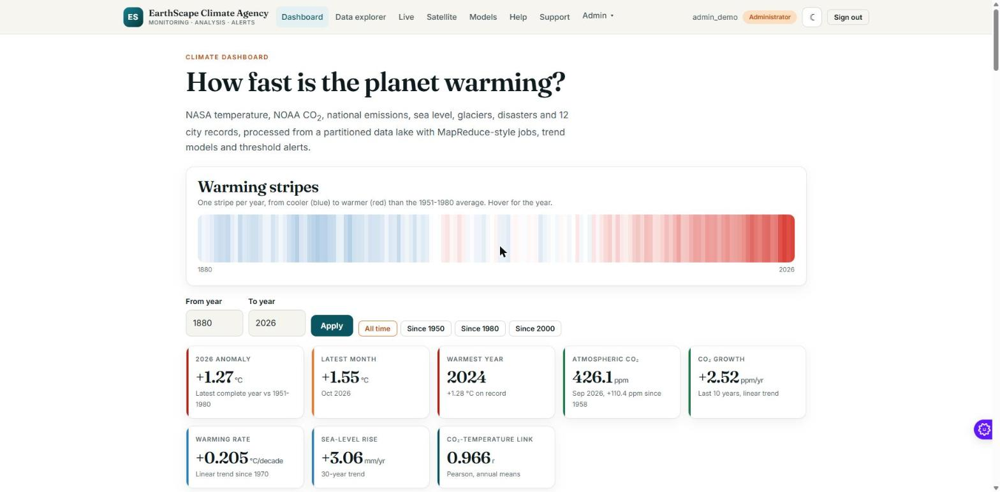
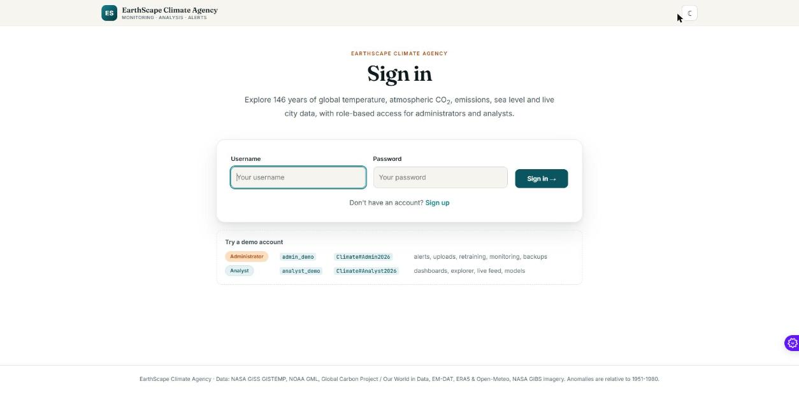
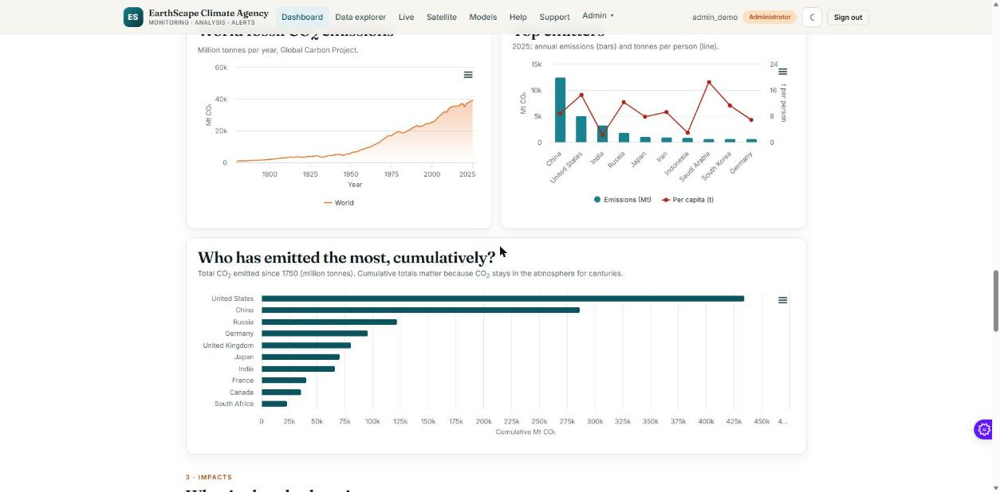
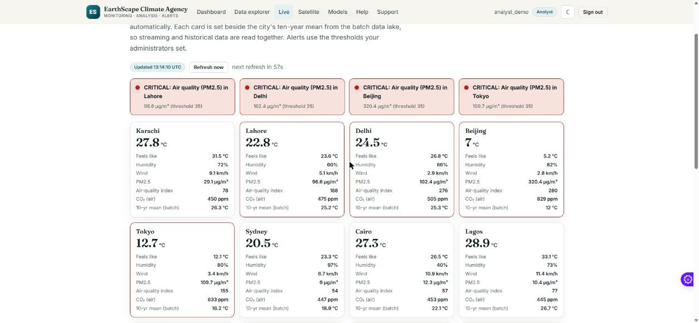
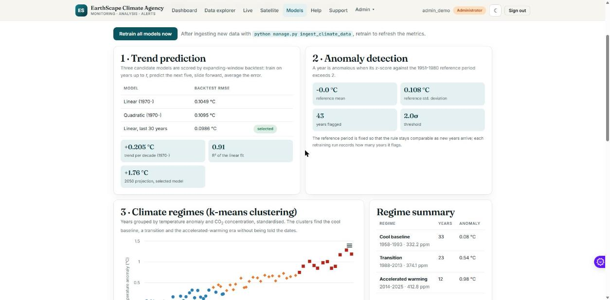
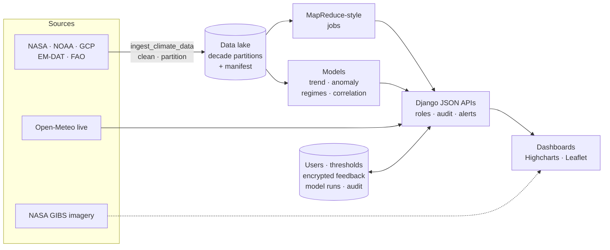

<div align="center">

# 🌍 EarthScape Climate Agency

### Climate-change monitoring, analytics and alerting platform

**Nine public datasets · a partitioned data lake · MapReduce-style processing · four ML models · real-time city feed · NASA satellite imagery · role-based access**


### 🔗 [**Live demo → climate-change-dashboard-eight.vercel.app**](https://climate-change-dashboard-eight.vercel.app)

[Features](#features) · [Screenshots](#screenshots) · [Quick start](#quick-start) · [Architecture](#architecture) · [Requirements coverage](#requirements-coverage) · [Documentation](#documentation) · [Assumptions](#assumptions-and-limitations)



</div>

---

## What is this?

An implementation of the **EarthScape Climate Agency** eProject brief: a portal where analysts explore climate data, spot anomalies, see where trends are heading and get warned when indicators cross agreed limits, while administrators manage thresholds, data, models and support.

Everything on screen is real data:

| Dataset | Source | Coverage |
|---|---|---|
| Global and hemispheric temperature anomaly | NASA GISS GISTEMP v4 | 1880 → today, monthly |
| Temperature by latitude band | NASA GISS GISTEMP v4 | 1880 → today |
| Atmospheric CO₂ | NOAA Mauna Loa | 1958 → today, monthly |
| CO₂ emissions, 19 countries + world | Global Carbon Project via Our World in Data | 1850 → today |
| Global mean sea level | Church & White / UHSLC | 1880 → 2020 |
| Glacier mass balance | EPA / WGMS | 1956 → 2023 |
| Natural disasters by type | EM-DAT | 1970 → today |
| World forest area | FAO | 1990 → today |
| 12 cities: annual mean temperature and hottest day | NASA POWER (MERRA-2 reanalysis) | 1981 → 2025 |
| Live weather, air quality, CO₂ | Open-Meteo (real-time) | now |
| Satellite imagery | NASA GIBS | daily |

## Features

- 🔐 **Role-based access.** Administrators and Analysts; sign-up, audit log, server-side enforcement.
- 🟥🟦 **Warming stripes** and a dashboard in five sections: the warming signal, drivers (emissions), impacts (sea level, glaciers, disasters, forests), regions and cities, cross-dataset correlation.
- 🗂️ **Data lake.** Datasets split into decade partitions with a manifest of source, checksum and data-quality figures. Queries open only the partitions they need.
- ⚙️ **MapReduce-style jobs.** Decade statistics are computed by per-partition mappers run in parallel, then reduced.
- 🤖 **Four models with a retraining loop.** Trend prediction chosen by expanding-window backtest, z-score anomaly detection, k-means climate regimes and a correlation matrix. Every retraining is recorded.
- 📡 **Real-time feed.** Weather, PM2.5 and CO₂ for 12 cities beside each city's long-term mean, with live alerts.
- 🛰️ **Satellite viewer.** NASA GIBS true colour, aerosol, vegetation, land temperature and snow layers by date.
- 🚨 **Configurable alerts.** Seven thresholds with normal / warning / critical states, editable by administrators.
- 💬 **Support desk.** Encrypted messages, administrator replies, status tracking.
- 🛠️ **Admin tools.** Dataset upload (CSV/JSON/XLS), performance monitor, audit trail, one-click backup.
- 🌗 **Light and dark themes**, keyboard-accessible, responsive.
- 📚 **In-app documentation.** User guide, tutorials, FAQ and glossary.

## Screenshots

| | |
|---|---|
| <br>**Sign in** | <br>**Drivers and impacts** |
| <br>**Live conditions and alerts** | <br>**Models and backtests** |

## Quick start

```bash
git clone https://github.com/ari161-bit/climate-change-dashboard.git
cd climate-change-dashboard
python -m venv .venv
.venv\Scripts\activate           # macOS/Linux: source .venv/bin/activate
pip install -r requirements.txt
python manage.py runserver
```

Open <http://127.0.0.1:8000/>. The first run copies `deploy/demo.sqlite3` to `db.sqlite3`, so groups, thresholds and demo accounts already exist.

| Role | Username | Password |
|---|---|---|
| Administrator | `admin_demo` | `Climate#Admin2026` |
| Analyst | `analyst_demo` | `Climate#Analyst2026` |

Refresh the data with `python manage.py ingest_climate_data`; run the tests with `python manage.py test climate --settings=mysite.test_settings`. Full instructions: [docs/INSTALL.md](docs/INSTALL.md).

> The hosted demo runs on serverless hosting where each server instance has its own throwaway database. Feedback, uploads and threshold edits made there are not shared between instances and disappear when an instance restarts. The application itself is stateless; point it at Postgres for persistence.

## Architecture



The brief names Hadoop, HDFS, Impala and Tableau. Those are built for clusters and terabytes; this data is about 300 KB. The same architecture is kept (partitioned storage, map/reduce processing, a query layer, interactive visualisation) at a scale that runs on a laptop and on serverless hosting. [docs/ARCHITECTURE.md](docs/ARCHITECTURE.md) has the data-flow diagrams, workflows, data model and security design.

## Requirements coverage

| Brief | Where it is met |
|---|---|
| User authentication and authorisation, roles | Django auth, groups, `admin_required`, role-restricted data (raw CSVs, admin-only uploads) |
| Data ingestion: diverse, historical and real-time | `ingest_climate_data` (9 datasets), live Open-Meteo feed, NASA GIBS imagery, admin uploads |
| Data storage: HDFS, partitioning | Partitioned lake with manifest and partition pruning *(adapted, see above)* |
| Data processing: MapReduce, patterns, missing data | `pipeline.py` jobs; k-means patterns; gap handling with quality reporting |
| Real-time processing integrated with batch | Live cards set beside batch 10-year means |
| Machine learning, regular refinement | `ml.py`; backtest model selection; recorded retraining |
| Interactive dashboards | Filters, zoom, toggles, exports, themes, dataset explorer |
| Notifications and alerts | Seven configurable thresholds, live alerts *(in-app; no email/SMS)* |
| Feedback and support | Encrypted support desk with replies |
| Performance monitoring | Admin performance monitor |
| Security: encryption, compliance | Fernet-encrypted feedback, HTTPS/HSTS/secure cookies, CSP, audit log |
| Reliability: backups | `backup_data` command and admin download |
| Scalability | Stateless app, signed sessions, read-only lake |
| Documentation, video | `docs/`, in-app Help; video script provided |

The line-by-line version with test references is [docs/REQUIREMENTS.md](docs/REQUIREMENTS.md).

## Documentation

| Document | Contents |
|---|---|
| [docs/ARCHITECTURE.md](docs/ARCHITECTURE.md) | Problem definition, component and data-flow diagrams, workflows, ER model, security, scalability |
| [docs/REQUIREMENTS.md](docs/REQUIREMENTS.md) | Requirement-by-requirement traceability and deliverables checklist |
| [docs/TESTING.md](docs/TESTING.md) | Automated test inventory, test data, manual acceptance checklist |
| [docs/INSTALL.md](docs/INSTALL.md) | Installation, commands, configuration, Vercel deployment, troubleshooting |
| [docs/VIDEO_SCRIPT.md](docs/VIDEO_SCRIPT.md) | Six-minute walkthrough script for the demo video |
| In-app **Help** | User guide, four tutorials, role matrix, FAQ, glossary |

## Project layout

```
climate/
├── lake.py              partitioned storage, manifest, gap handling
├── pipeline.py          MapReduce-style job runner
├── analytics.py         dashboard computations and alert evaluation
├── ml.py                trend / anomaly / regime / correlation models + retraining
├── live.py              real-time Open-Meteo client with caching
├── monitor.py           latency, error and stage-timing monitor
├── crypto.py            field-level encryption
├── views.py             pages, JSON APIs, admin tools
├── models.py            thresholds, feedback, model runs, audit, uploads
├── middleware.py        monitoring + Content-Security-Policy
├── management/commands/ ingest_climate_data · seed_climate · backup_data
├── data/lake/           the partitioned datasets and manifest.json
├── templates/ static/   UI
└── tests.py             31 tests
deploy/demo.sqlite3      sanitized seed database
docs/                    design, requirements, tests, install, video script
api/index.py             Vercel entry point
myshop/                  earlier shop / real-estate module (kept, mounted at /myshop/)
```

## Assumptions and limitations

- Temperature is an **anomaly against 1951-1980**, as NASA publishes it, not an absolute temperature.
- The **2050 projection** extends recent statistical trends. It has no emissions scenarios or climate physics and is an illustration of the current trajectory, not a forecast.
- **Correlations** across datasets largely reflect shared long-term trends and do not show causation; the dashboard says so.
- Disaster counts rise partly because **reporting improved**; read that trend with care.
- **Real-time** here means as fresh as the free Open-Meteo feed (cached up to five minutes). The satellite layers publish with a delay of a day or two.
- **Alerts** are shown in the portal. There is no email or SMS delivery.
- **HDFS/MapReduce/Impala/Tableau** are replaced by a partitioned lake, map/reduce jobs, pandas and Highcharts, as explained above.
- **Hosting:** the Vercel demo uses an ephemeral per-instance database. Sessions are stateless so sign-in works across instances; written data does not persist.
- Highcharts is self-hosted and free for non-commercial use; check its licence for commercial use.
- The demo credentials are public by design and carry no superuser rights.
- This is a coursework and portfolio project, not a certified climate-science product.

## Credits

NASA GISS (GISTEMP Team, Lenssen et al. 2019) · NOAA Global Monitoring Laboratory, Dr Pieter Tans and Dr Ralph Keeling · Global Carbon Project, EM-DAT (CRED), FAO and Our World in Data · Church & White (2011), UHSLC · EPA and WGMS · NASA POWER (MERRA-2) and Open-Meteo · NASA GIBS / EOSDIS · Highcharts · Leaflet · Warming stripes concept by Prof. Ed Hawkins, University of Reading.
