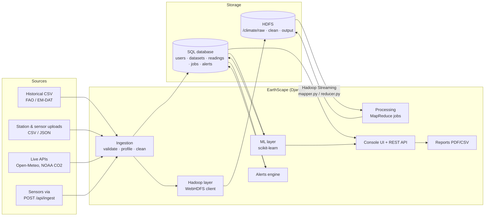
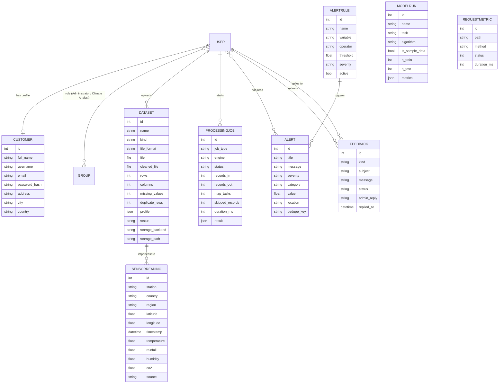
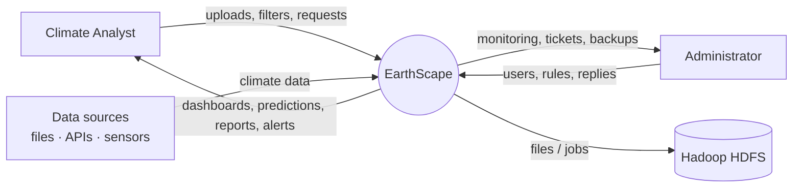
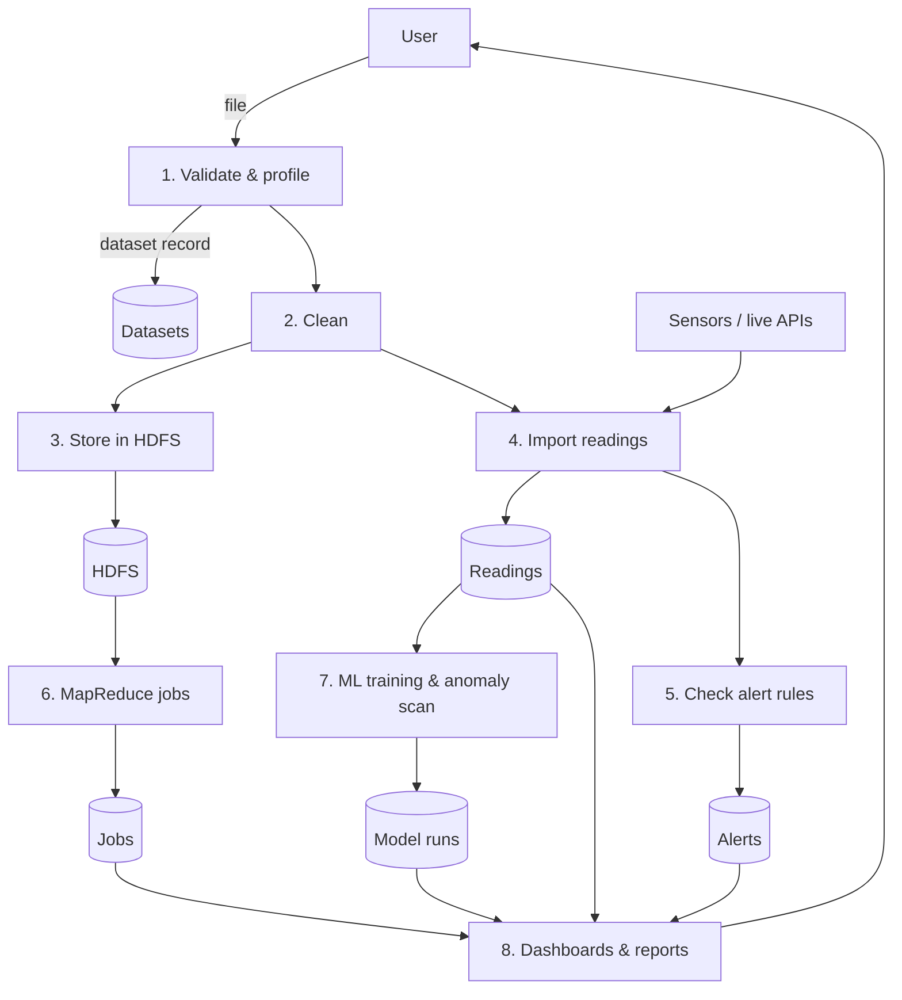
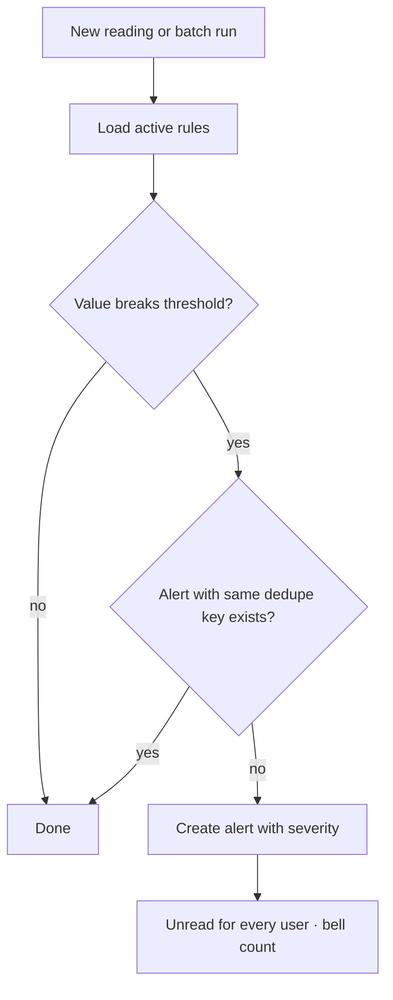
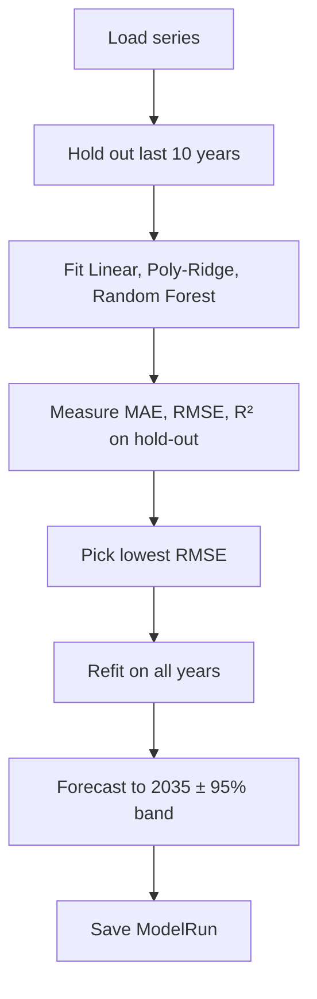
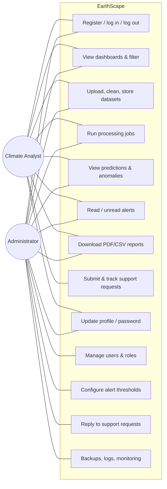

# EarthScape Climate Agency
## Climate Change Analysis and Monitoring System: Project Documentation

Aptech eProject · Big Data (Hadoop) + Machine Learning + Web

---

## Contents
1. Introduction
2. Problem Definition
3. Objectives
4. Functional Requirements
5. Non-Functional Requirements
6. Hardware and Software Requirements
7. System Architecture
8. Database Design
9. Data Flow Diagrams
10. Flowcharts
11. Use Case Diagrams
12. Implementation Details
13. Machine Learning Methodology
14. Testing and Test Cases
15. Installation Instructions
16. User Manual
17. Developer Documentation
18. Limitations and Future Enhancements

> Diagrams are written in Mermaid. They render on GitHub and in VS Code (with the *Markdown Preview Mermaid Support* extension).

---

## 1. Introduction

Climate change produces more frequent and severe weather events. The EarthScape Climate Agency collects climate data from satellites, weather stations and environmental sensors, and needs one platform to **store** it at scale, **process** it in parallel, **analyse** it with machine learning, **visualise** it, and **alert** people when something unusual happens.

EarthScape is that platform: a Django web application backed by Hadoop HDFS and MapReduce, with a scikit-learn analytics layer and a role-based console for Administrators and Climate Analysts.

## 2. Problem Definition

- Climate data arrives in many formats (CSV, JSON) and from many sources (historical archives, stations, sensors, satellites), often with **missing values and duplicates**.
- The volume grows constantly, so storage must be **distributed and fault tolerant** (HDFS) and processing must be **parallel** (MapReduce).
- Analysts need to see **trends, anomalies and correlations**, and **forecasts** with honest accuracy figures.
- Stakeholders must be **notified** when thresholds are crossed.
- Access must be **secure** and **role-based**.

## 3. Objectives

1. Secure registration, login and role-based access (Administrator, Climate Analyst).
2. Ingest CSV/JSON climate tables with validation, profiling, cleaning and history; preserve GeoTIFF imagery as catalogued source files.
3. Store datasets in HDFS with a partitioned layout; process them with MapReduce.
4. Detect anomalies, trends and correlations; predict temperature and rainfall with evaluated ML models.
5. Provide interactive dashboards with filters (date range, country, region, variable).
6. Raise configurable, de-duplicated alerts with severity and read/unread status.
7. Provide support/feedback tracking and downloadable PDF/CSV reports.
8. Log, monitor performance, back up data, and be testable.

## 4. Functional Requirements

| # | Requirement (Aptech spec) | Where it is implemented |
|---|---|---|
| FR1 | Authentication, roles, access control | `views.signup/login_view/logout_view`, `forms.py`, `roles.py` (`admin_required`, `api_login_required`), `console_views.users_view` |
| FR2 | Data ingestion: diverse datasets, historical + real-time, common formats | `ingestion.py` (CSV/JSON tables, GeoTIFF catalogue, validation, profiling, cleaning, import), `live.py` (Open-Meteo, NOAA CO₂), `console_views.api_ingest` |
| FR3 | HDFS storage, partitioning | `hadoop.py` (WebHDFS client, `/climate/{raw,clean}/<kind>/year=YYYY/month=MM/`), `hadoop/start_hdfs.cmd` |
| FR4 | MapReduce parallel processing, patterns/anomalies/correlations, missing data | `mapreduce.py` (local engine + jobs), `hadoop/mapper.py`, `hadoop/reducer.py`, `hadoop/run_mapreduce.cmd`, `hadoop.run_streaming_job` |
| FR5 | Real-time streaming integrated with batch | `api_ingest` + "Pull live data" create readings that flow into the same dashboards, alerts and models |
| FR6 | ML: prediction, anomaly detection, trends, correlation, refreshed models | `ml.py`, `ModelRun` history, "Retrain models" |
| FR7 | Interactive dashboards and visualisations | `templates/climatechanges/console/*`, `static/js/console.js` (Chart.js + Plotly maps) |
| FR8 | Notifications and configurable alerts | `alerts.py`, `AlertRule`, `Alert`, bell + Alerts page |
| FR9 | Feedback and support | `Feedback` model, `console_views.support_view/support_detail` |
| FR10 | Reports (PDF + CSV) | `reports.py` (built-in PDF writer), Reports page |

## 5. Non-Functional Requirements

| Requirement | Implementation |
|---|---|
| **Performance monitoring** | `middleware.PerformanceMonitorMiddleware` times every console/API request (`RequestMetric`), adds a `Server-Timing` header, logs slow (>1.5 s) and failing requests; the Data Processing page shows average, p95, errors and slowest endpoints |
| **Optimisation** | cached analytics keyed on a data version (`console_views.cached`); DB-side filtering for alert evaluation (34 s → 0.2 s); indexed reading columns; HDFS status cached 30 s |
| **Encryption** | Fernet (AES-128-CBC + HMAC-SHA256) for uploads, cleaned files and backups; HTTPS/TLS 1.2+ with HSTS through Apache; MongoDB/HDFS on localhost (enable TLS/encryption zones in production: see `hadoop/impala_tables.sql`) |
| **Security** | Django password hashing (PBKDF2), password validators, CSRF on all forms, session cookies HttpOnly, `X-Frame-Options: DENY`, `nosniff`, Content-Security-Policy, role checks on every view, API auth (401), token-protected ingest, safe `next` redirects |
| **Secure file uploads** | extension whitelist (.csv/.json), size limit (20 MB), binary-content check, parsing validation, server-generated file names, files **not** publicly served (download only through a login-protected view) |
| **Input validation** | Django forms, model choices, numeric parsing in ingest API, per-row error reporting |
| **Error handling** | jobs record status + error; user-facing messages; unhandled exceptions logged with stack traces |
| **Logging** | `logs/earthscape.log` (rotating, 5 × 2 MB) + console |
| **Backup** | `python manage.py backup_earthscape --keep 14` zips DB + uploads + data; button in console; schedule with Windows Task Scheduler |
| **Maintenance notices** | admins schedule windows in Settings; banner on every page beforehand |
| **Resource monitoring** | psutil CPU/memory/disk/process samples every minute, 24 h chart |
| **Health check** | `/climatechanges/api/health/` for the load balancer |
| **Scalability / 99% availability** | stateless app servers (sessions in DB) so several instances can run behind a load balancer; HDFS replication for data; switch SQLite → PostgreSQL via `DATABASES`; see section 7 |

## 6. Hardware and Software Requirements

**Hardware (development / demo)**: 64-bit CPU with 4+ cores, 8 GB RAM (16 GB recommended with Hadoop), 5 GB free disk.

**Hardware (production guideline)**: 2+ app servers (4 vCPU, 8 GB), managed PostgreSQL, Hadoop cluster of 3+ DataNodes (replication 3).

**Software**

| Component | Version |
|---|---|
| Windows 10/11 (or Linux) | |
| Python | 3.12 |
| Django | 6.1 |
| pandas / NumPy / scikit-learn / SciPy | 3.0 / 2.5 / 1.9 / 1.18 |
| Java JDK | 8 (1.8.0_202) |
| Hadoop | 2.9.2 (HDFS + Streaming) |
| Browser | current Chrome / Edge / Firefox |
| Editor | Visual Studio Code, Jupyter Notebook |

## 7. System Architecture



**Layers**

| Layer | Modules |
|---|---|
| Presentation | `templates/climatechanges/console/*`, `static/css/console.css`, `static/js/console.js` |
| Application | `console_views.py`, `views.py`, `forms.py`, `roles.py`, `middleware.py` |
| Domain services | `ingestion.py`, `mapreduce.py`, `ml.py`, `alerts.py`, `reports.py`, `live.py`, `datasources.py` |
| Big data | `hadoop.py`, `hadoop/*.cmd`, `hadoop/mapper.py`, `hadoop/reducer.py` |
| Persistence | `models.py` (Django ORM) |

**Scaling to 99% availability**: run 2+ identical app instances behind a load balancer (sessions and data live in the database, so any instance can serve any user); use PostgreSQL with a standby replica; HDFS keeps 3 replicas per block across DataNodes; nightly `backup_earthscape`; health checking via `/climatechanges/api/summary/`; long jobs can move to a task queue (Celery/RQ) without changing the job functions.

## 8. Database Design



Key design points: `SensorReading.source` (live/upload/api/sample) keeps real and sample data separate; `Alert.dedupe_key` is unique so the same event never alerts twice; `Dataset.profile` (JSON) holds per-column statistics, preview, cleaning and import results.

## 9. Data Flow Diagrams

**Level 0 (context)**



**Level 1**



## 10. Flowcharts

**Dataset upload**

```mermaid
flowchart TD
  A[Select file + type] --> B{CSV, JSON or GeoTIFF?}
  B -- no --> X[Reject: message]
  B -- yes --> C{≤ 20 MB?}
  C -- no --> X
  C -- yes --> D{GeoTIFF?}
  D -- yes --> I[Validate TIFF signature · encrypt and catalogue source]
  D -- no --> E[Parse table · profile types, missing, duplicates, preview]
  I --> F[Save dataset · status Validated]
  E --> F
  F --> G{User action}
  G -- Clean tables --> H[Drop dupes/empty rows, fill numeric gaps with median]
  G -- Store --> I{HDFS online?}
  I -- yes --> J[WebHDFS write to /climate/raw|clean/...]
  I -- no --> K[Local staging · warn user]
  G -- Import tables --> L[Create readings · run alert rules]
```

**Alert evaluation**



**Model training**



## 11. Use Case Diagrams



## 12. Implementation Details

| Area | Details |
|---|---|
| Authentication | `CreateUserForm` (Django `UserCreationForm`) + `CustomerRegistrationForm`; `authenticate()` / `login()` / `logout()`; `ProfileUpdateForm`; `PasswordChangeForm` |
| Roles | Django groups *Administrator* / *Climate Analyst*; `roles.is_admin`, `assign_role`, `admin_required` |
| Ingestion | pandas parsing with encoding fallback; JSON lists or `{ "records": [...] }`; column alias detection (e.g. `precip` → rainfall) |
| HDFS | WebHDFS REST (`LISTSTATUS`, two-step `CREATE`, `OPEN`); partition path `/climate/<zone>/<kind>/year=YYYY/month=MM/<file>` |
| MapReduce | local engine: split → parallel map tasks (thread pool) → shuffle/sort → reduce, counts skipped rows; Hadoop Streaming job with Python mapper/reducer, launched from the console, output read from HDFS |
| Analytics cache | Django cache keyed on reading count/max id + data file timestamps |
| Visualisation | Chart.js 4 (line, bar, scatter, gradient fills), Plotly choropleth maps (ISO-3) |
| PDF | dependency-free PDF 1.4 writer (`reports._PDF`): Helvetica, tables, paging, footer |
| Live data | Open-Meteo multi-location current weather; NOAA CO₂ monthly trend (cached to `data/co2_cache.json`) |

## 13. Machine Learning Methodology

**Data**: real FAO temperature change (°C vs 1951-1980) for 200+ countries and 5 continents, 1961-2023; real EM-DAT disaster counts 1980-2024; station readings (sample unless real station data is uploaded).

**Temperature trend prediction**
- Features: year. Target: annual temperature change.
- Candidates: Linear Regression; Polynomial (degree 2) + Ridge (standardised); Random Forest (200 trees).
- Validation: **time-based hold-out**: train on all years except the last 10, test on the last 10 (no shuffling, no leakage).
- Metrics: MAE, RMSE, R² on the hold-out years. Best = lowest RMSE, refit on all data, forecast to 2035 with a ±1.96·σ(residuals) band.
- Result on the World series (run 4 Nov 2026): Polynomial-Ridge RMSE 0.186 °C, MAE 0.154 °C, R² 0.215; Linear RMSE 0.281 (R² −0.79); Random Forest RMSE 0.470 (R² −3.99). Random forests can't extrapolate past the training range, which is why they lose on future years. *These numbers are recomputed live in the app.*

**Rainfall prediction**
- Features: month (sin/cos), latitude, temperature, humidity, region one-hot, station-month climatology computed **from training rows only**.
- Model: Random Forest (250 trees). Baseline: station-month mean.
- Validation: random 80/20 split (seed 42).
- Result (sample data, 4 Nov 2026): RF RMSE 57.2 mm vs baseline 54.0 mm, so the RF does **not** beat the baseline on this data, and the app says so. The sample data is seasonal climatology plus noise, so the baseline is close to the best possible model; real station data with more signal (pressure, wind, lagged rain) is needed for ML to add value.

**Anomaly detection**
- Temperature: z-score of each country's yearly value against its own 1961-2023 history; flags |z| ≥ threshold (default 2.5) in the last 3 years.
- Stations: Isolation Forest (200 trees, contamination 2%) on per-station standardised temperature, rainfall and humidity.

**Correlation analysis**: Pearson r with p-value between global temperature change and annual disaster counts (real), plus a correlation matrix of station variables. Caveat shown in the UI: reporting of disasters also improved over time.

**Model refresh**: "Retrain models" or the `train_models` job stores each run (`ModelRun`) with its metrics, so performance can be tracked as data changes.

## 14. Testing and Test Cases

Automated: `python manage.py test climatechanges` (44 tests, all passing on 4 Nov 2026). Tests use a temporary database and folders, force HDFS offline and disable MongoDB writes so they never touch real services.

| ID | Area | Test case | Expected |
|---|---|---|---|
| T01 | Registration | valid sign-up | user + customer created, Climate Analyst role, passwords hashed |
| T02 | Registration | mismatched / weak password | rejected, no user |
| T03 | Registration | duplicate email | rejected with message |
| T04 | Login | correct credentials, then logout | console accessible, then redirected to login |
| T05 | Login | wrong password | error message |
| T06 | Security | `?next=//evil.com` | redirect stays on site |
| T07 | Authorization | 10 console pages anonymously | all redirect to login |
| T08 | Authorization | API anonymously | 401 JSON |
| T09 | RBAC | analyst opens User Management | 403; admin 200 |
| T10 | Admin | change role, deactivate user | applied |
| T11 | Profile | update profile, change password | saved; new password works |
| T12 | Upload | CSV with gaps + duplicates | rows=4, missing=2, duplicates=1, preview, importable |
| T13 | Upload | JSON `{records:[...]}` | parsed as JSON dataset |
| T14 | Upload | .exe / binary / empty | rejected |
| T15 | Upload | over size limit | rejected |
| T16 | Processing | clean → import → store | duplicate removed, gaps filled, readings imported, heat alert raised, staged with partition path when HDFS off |
| T17 | Security | dataset download logged out | redirected to login |
| T18 | Real-time API | missing token | 401 |
| T19 | Real-time API | 1 valid + 1 invalid reading | 201, 1 created, 1 error, alert raised |
| T20 | MapReduce | engine with a bad row | correct sums, 1 skipped, 2 map tasks |
| T21 | MapReduce | 4 jobs | success, outputs + Hadoop command recorded |
| T22 | MapReduce | unknown job | status failed, no crash |
| T23 | ML | temperature trend | 10-year hold-out, best = lowest RMSE, forecast to 2035, positive warming |
| T24 | ML | rainfall model | trained, flagged as sample data |
| T25 | ML | anomalies + correlation | Isolation Forest ran, valid r |
| T26 | ML | train_all | 3 runs recorded, sample flag correct |
| T27 | Data labels | sample rows | labelled "sample data" |
| T28 | Alerts | threshold + dedupe + read/unread | 1 alert, no duplicate, read clears unread |
| T29 | Alerts | analyst edits rule | blocked; admin allowed |
| T30 | Alerts | temp-anomaly rule on real data | alerts created |
| T31 | Support | submit → other user blocked → admin resolves → user sees reply | as described |
| T32 | Reports | all 6 reports × PDF/CSV | valid `%PDF-1.4 … %%EOF`, CSV content |
| T33 | Dashboard | 11 pages with filters | 200 |
| T34 | API | series filter / bad variable | data + 400 |
| T35 | Backup | make_backup | encrypted .zip.enc created |
| T36 | Encryption | upload then read file on disk | ciphertext on disk, download returns original bytes |
| T37 | Encryption | tampered token | rejected |
| T38 | Backup | encrypted backup round trip | decrypts to a zip with the datasets |
| T39 | Reliability | `/api/health/` anonymously | 200 `{"status":"ok"}` |
| T40 | Reliability | admin publishes maintenance notice | banner on console and public site |
| T41 | RBAC | analyst publishes notice | blocked |
| T42 | Docs/monitoring | help center, processing page | FAQ, resource and MongoDB cards shown |
| T43 | BI | Tableau extract | zip with fact/dim tables |
| T44 | Standards | series API | unit `degC` returned |

Manual checks done: console pages in a browser at 1440 px (Overview, Analytics with world map of 213 countries, Predictions), real HDFS writes via WebHDFS, real Hadoop Streaming job from the console (45 years, ~13 s).

## 15. Installation Instructions

1. Install Python 3.12 and (for Hadoop) JDK 8 + Hadoop 2.9.2 at `C:\hadoop\hadoop-2.9.2`.
2. Open a terminal:
   ```bash
   cd C:\amfahh\climatechanges
   pip install -r requirements.txt
   python manage.py migrate
   python manage.py setup_earthscape
   python manage.py createsuperuser
   python manage.py runserver
   ```
3. Hadoop (optional): run `hadoop\start_hdfs.cmd`, keep its two windows open. Check http://localhost:50070.
4. Open http://127.0.0.1:8000/climatechanges/ and log in.

Environment variables (optional): `EARTHSCAPE_INGEST_TOKEN`, `EARTHSCAPE_WEBHDFS`, `EARTHSCAPE_HDFS_USER`.

**Deployment checklist**: set `DEBUG=False`, a secret `SECRET_KEY`, `ALLOWED_HOSTS`, HTTPS with `SESSION_COOKIE_SECURE`/`CSRF_COOKIE_SECURE`, PostgreSQL, `collectstatic`, a WSGI server (waitress on Windows, gunicorn on Linux), and a scheduled backup.

## 16. User Manual

**Sign up / log in**: *Sign up* on the website → log in → you land on the console Overview.

**Overview**: KPI cards at the top; each shows whether its data is *real* or *sample*. Use the filter bar (dates, region, country, variable) and *Apply filters*.

**Climate Analytics**: pick a temperature series (World, a continent or a country). Hover charts for values; scroll on the map to zoom.

**Data Management**: choose a CSV/JSON table or GeoTIFF imagery file and its type → *Upload & validate*. Tables can be cleaned and imported as station readings (station + date columns required); GeoTIFFs are encrypted, catalogued and can be stored in HDFS. Try `sample_data/station_readings_sample.csv`.

**Data Processing**: pick a job → *Run job*. *Pull live data* fetches current weather and CO₂. *Climate disasters per year on Hadoop* runs a real Hadoop job (HDFS must be running).

**Predictions**: choose a series to compare models on held-out years; *Retrain models* refreshes all models.

**Anomaly Detection**: change the z-score threshold and *Re-run detection*.

**Alerts**: filter by state/severity/category, *Mark read/unread*, *Mark all read*, *Evaluate rules now*. Administrators edit thresholds in the rules table. The bell in the top bar shows unread alerts.

**Reports**: choose a report and scope → *Preview*, *CSV* or *PDF*.

**Support**: submit a request and follow its status. Administrators open a request, reply and set *In progress* / *Resolved*.

**Settings**: edit your profile and change your password. Administrators: *User Management* to change roles and deactivate accounts.

## 17. Developer Documentation

```
climatechanges/                 Django app
  models.py                     Customer, Feedback, Dataset, SensorReading, ProcessingJob, ModelRun, AlertRule, Alert, RequestMetric
  views.py                      public site, signup/login/logout/profile, landing data
  console_views.py              console sections + REST API
  forms.py                      auth/profile + console forms
  roles.py                      RBAC helpers/decorators
  datasources.py                loads FAO/EM-DAT data, readings DataFrames, data labels
  ingestion.py                  validate/profile/clean/import/store uploads
  hadoop.py                     WebHDFS client, partition paths, Hadoop Streaming runner
  mapreduce.py                  local MapReduce engine + all processing jobs
  ml.py                         models, anomalies, correlations, patterns
  alerts.py                     rules engine
  live.py                       Open-Meteo + NOAA CO2
  reports.py                    report builder, CSV + PDF writer
  middleware.py                 performance monitoring
  management/commands/          setup_earthscape, seed_sample_data, backup_earthscape
  templates/climatechanges/console/   console pages
  static/css/console.css, static/js/console.js
  tests.py                      35 tests
hadoop/                         start_hdfs.cmd, run_mapreduce.cmd, mapper.py, reducer.py
data/                           real datasets (+ hdfs_staging/, co2_cache.json)
sample_data/                    example upload files
notebooks/ml_exploration.ipynb  ML exploration
docs/                           this document
```

**REST API** (session login required unless stated)

| Method | Path | Description |
|---|---|---|
| GET | `/climatechanges/api/summary/` | headline numbers, HDFS status |
| GET | `/climatechanges/api/alerts/unread/` | unread count + latest 8 |
| GET | `/climatechanges/api/series/?variable=&region=&country=&start=&end=` | monthly series |
| POST | `/climatechanges/api/ingest/` | **token** (`X-API-Token`): one reading or a list (max 1000) |

**Adding a processing job**: write a function returning `(MapReduceResult, input_path)` in `mapreduce.py`, register it in `JOBS`, and add the choice to `ProcessingJob.JOB_TYPES` (+ migration).

**Adding an alert variable**: add to `AlertRule.VARIABLES` and handle it in `alerts.evaluate_rules`.

## 18. Limitations and Future Enhancements

**Limitations**
- Station rainfall/humidity history is **sample data** until real station files are uploaded; the rainfall model's metrics describe that sample data only.
- Hadoop runs as a single-node HDFS with MapReduce in local mode (no YARN cluster configured); the Streaming job is launched synchronously from the web request (about 13 s).
- React was not used (see README); MongoDB holds climate documents while users/app state stay in SQL.
- Charts need internet access to load Chart.js/Plotly from the CDN.
- GeoTIFF imagery is preserved, catalogued and storable in HDFS; raster analysis and visualization are future work.
- In-app notifications only (no email/SMS yet).

**Future enhancements**
- Background task queue (Celery/RQ) for long jobs and scheduled live pulls.
- YARN multi-node cluster and Hive/Spark for SQL-style analysis.
- Email/SMS/webhook alert channels.
- Real station archives (e.g. NOAA GHCN) to replace sample data; gridded satellite data (NetCDF).
- Seasonal models (SARIMA, gradient boosting with lagged features) and model monitoring/drift checks.
- PostgreSQL + Docker deployment with CI running the test suite.
