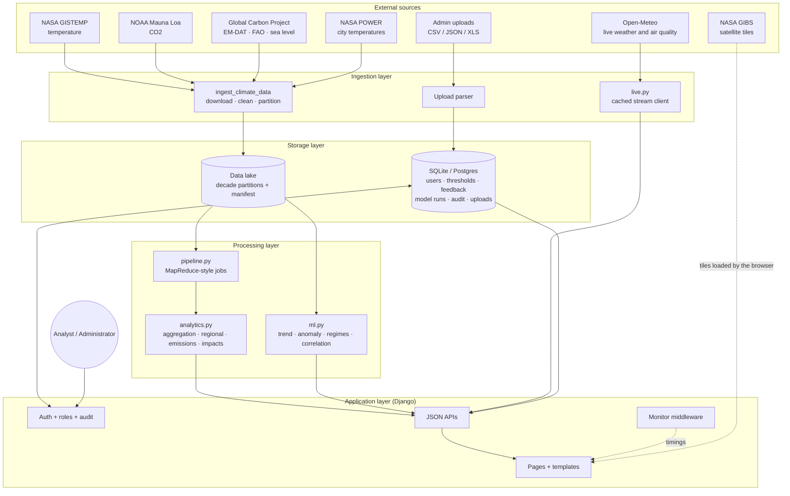
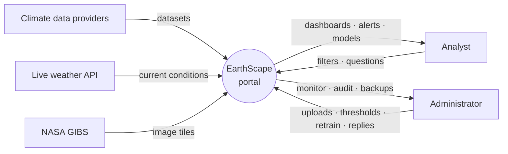
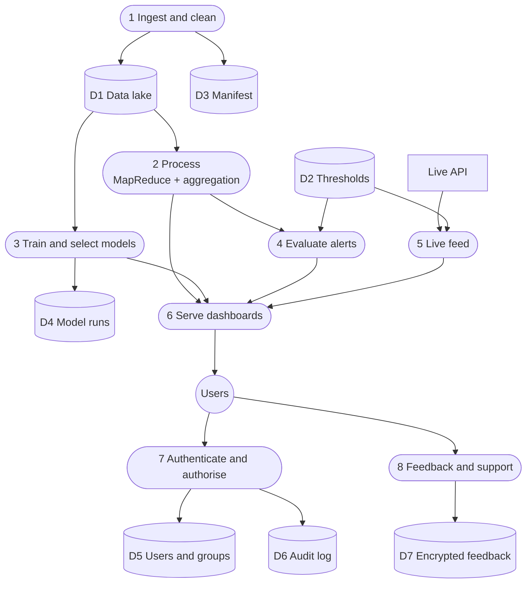
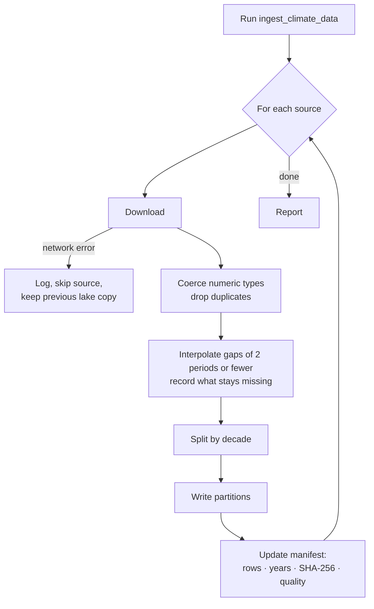
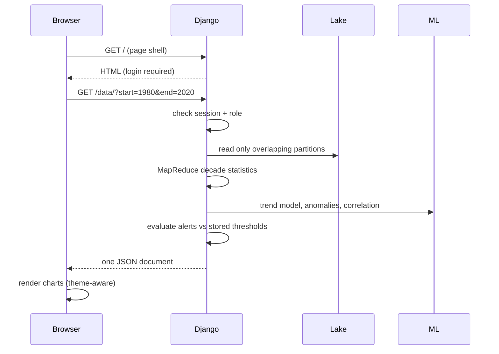
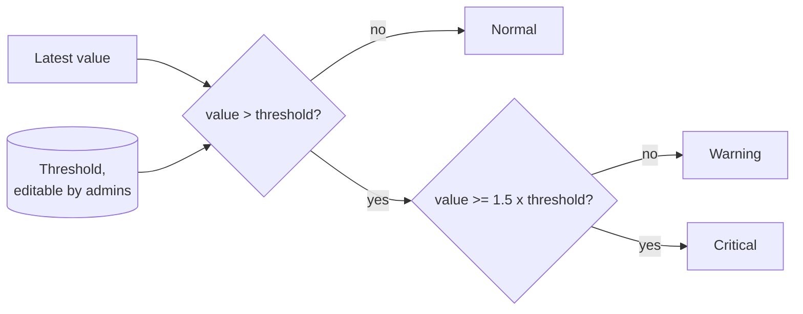
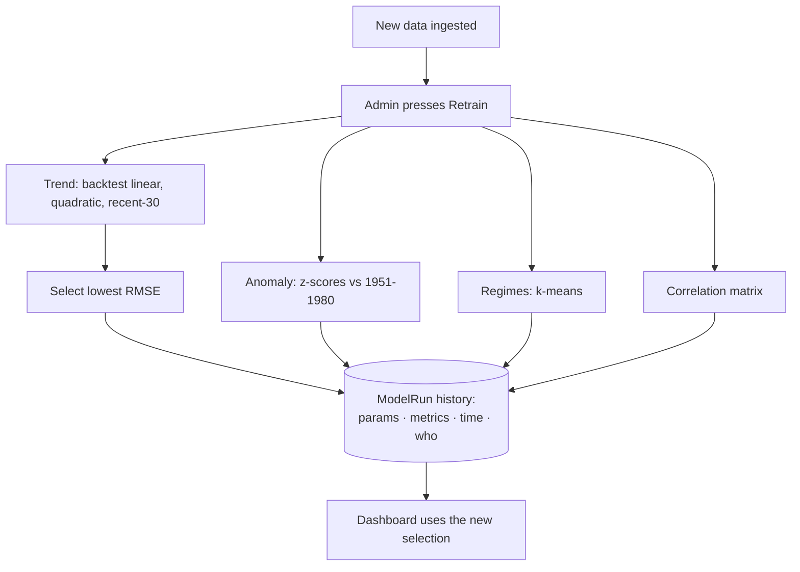
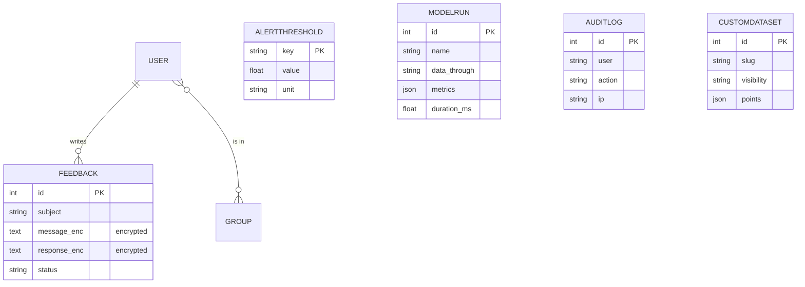

# Architecture and design specification

This document covers the problem definition, design, data flows and workflows of the EarthScape Climate Agency portal. Diagrams are Mermaid and render directly on GitHub.

## 1. Problem definition

The EarthScape Climate Agency collects climate data from satellites, weather stations and sensors and needs a platform to **store it, process it, find patterns and anomalies, predict trends, alert stakeholders and let analysts explore it**, with access limited by role. The original brief assumes a Hadoop/HDFS/Impala/Tableau stack; this implementation keeps the same *architecture and programming model* at a scale and cost that suits the data (a few hundred kilobytes), so it runs on a laptop and on serverless hosting.

## 2. Component overview

| Layer | Brief's technology | This implementation | Why |
|---|---|---|---|
| Distributed storage | HDFS | Partitioned file lake (`climate/data/lake/<dataset>/decade=<n>/part-0000.csv`) + `manifest.json` | Same layout idea (blocks, partition pruning, metadata); no cluster needed for ~300 KB |
| Batch processing | Hadoop MapReduce | `pipeline.run_job`: per-partition `mapper` in a thread pool, shuffle by key, `reducer` | Same programming model |
| Query engine | Impala | pandas on pruned partitions | Same role: fast ad-hoc reads |
| Real-time | Streaming | `live.py`: batched Open-Meteo calls, 5-minute cache, threshold alerts, merged with batch statistics | |
| ML | R / Python | NumPy/pandas models in `ml.py` | Runs on serverless, no heavy dependencies |
| Visualisation | Tableau | Highcharts dashboards in the browser, Leaflet + NASA GIBS | Embedded, interactive, role-aware |
| Metadata store | MongoDB | Django ORM (SQLite locally; any Django database in production) | |

## 3. Data flow diagrams

### Level 0: context

### Level 1: processes and stores

## 4. Workflows

### 4.1 Data ingestion

NOAA's own server is occasionally unreachable, so CO2 falls back to a public mirror of the same series. One failing source never aborts the others.

### 4.2 Dashboard request

### 4.3 Alerting

Climate alerts are recalculated on each dashboard load; live alerts on each live refresh (heat uses 1.15x and PM2.5 2x as the critical multiples).

### 4.4 Model retraining

## 5. Data model

## 6. Security design

| Control | Implementation |
|---|---|
| Authentication | Django auth, password hashing (PBKDF2), password validators on sign-up |
| Authorisation | Two roles (Administrators, Analysts) via groups; every admin view uses `admin_required`; checked server-side |
| Data-level access | Raw CSV export and "administrators only" uploaded datasets are hidden from analysts |
| Encryption in transit | HTTPS on Vercel; secure cookies, HSTS and a proxy-aware scheme check when `DEBUG` is off |
| Encryption at rest | Feedback messages and replies encrypted with Fernet (AES-128-CBC + HMAC) using a key derived from `SECRET_KEY` |
| Sessions | Signed, HTTP-only, SameSite=Lax cookies; 8-hour lifetime; stateless across server instances |
| CSRF | Django middleware on every POST; a failure returns the user to sign-in with an explanation |
| Content-Security-Policy | Restricts scripts, styles, images and connections to the app, Google Fonts and NASA GIBS |
| Input handling | Length and type validation; uploads limited to 2 MB and to CSV/JSON/XLS; open-redirect protection on `next` |
| Audit | Sign-in, failed sign-in, sign-up, uploads, downloads, retraining, threshold changes, backups |

## 7. Performance and scalability

- **Partition pruning:** a request for 1990-1999 opens one partition file, not all fifteen.
- **Caching:** datasets are cached in memory after first read; the live feed is cached for 5 minutes.
- **Monitoring:** `MonitorMiddleware` and `monitor.stage()` record latency, error rate and stage timings (Admin → Performance monitor).
- **Horizontal scaling:** the app is stateless (signed-cookie sessions, read-only lake), so more instances can be added behind a load balancer. The remaining shared state is the Django database; use Postgres in production.
- **Reliability:** per-source ingestion isolation, a mirror fallback for CO2, cached live data when the upstream API is down, and downloadable or scheduled backups (`backup_data`).
